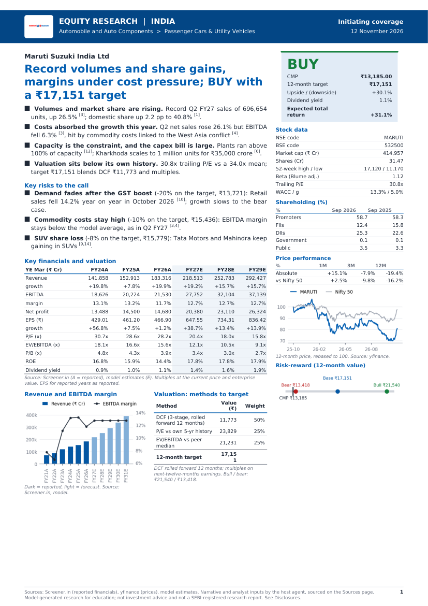
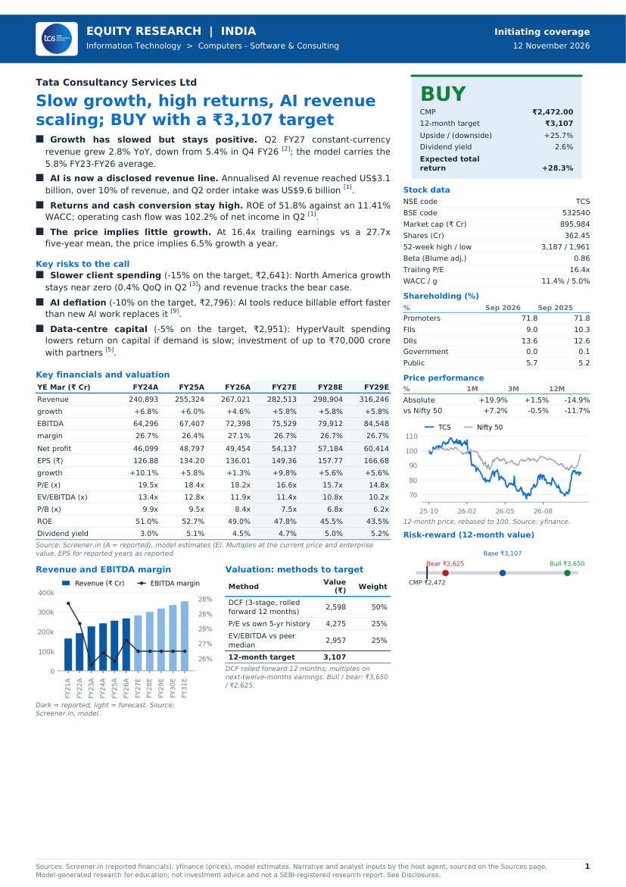

# Equity Research Agent (NSE/BSE)

[](https://opensource.org/licenses/MIT)
[](https://www.python.org/)

**Turn an NSE or BSE ticker into a broker-style equity research report, a live Excel valuation model and a DCF, built on reported Screener.in financials and live market data.**

<table>
  <tr>
    <td width="50%"></td>
    <td width="50%"></td>
  </tr>
  <tr>
    <td align="center"><sub>Maruti Suzuki (MARUTI), page 1</sub></td>
    <td align="center"><sub>Tata Consultancy Services (TCS), page 1</sub></td>
  </tr>
</table>

<sub>Real-data snapshots from a live run on 12 November 2026. Figures change with each run.</sub>

Give it an NSE or BSE ticker and it returns, built from **reported Screener.in data**:

1. **An Excel financial model** with a Tesla-style executive Dashboard in the company's own brand colour, a
   3-statement model (reported actuals + 5-year forecast formulas), a 3-stage DCF, valuation summary, peers and
   scenarios. Every valuation item is a live formula.
2. **A broker-style PDF research report** (front page with rating, target and data sidebar, story in charts,
   quarterly results, financial analysis, multi-year peer comparison, valuation with scenarios, technical view,
   financial statements, sources and disclosures) that uses the same numbers.
3. **A `summary.json`** and a **`research_pack.json`** for the AI agent (Claude, Hermes, Codex, Cursor) that ran it.

The tool makes no LLM calls. The host agent researches the company and writes the qualitative sections
(`<SYMBOL>_narrative.json`, every fact cited) and, optionally, sourced changes to the forecast
(`<SYMBOL>_analyst_inputs.json`); the second run renders the final report. No login, API key or browser is
needed. See [AGENT.md](AGENT.md) for the instructions an AI agent follows.

```bash
pip install -r requirements.txt
python generate_equity_report.py --ticker TATATECH            # step 1: draft PDF, Excel, research pack
# the host agent writes output/TATATECH_narrative.json (+ optional output/TATATECH_analyst_inputs.json)
python generate_equity_report.py --ticker TATATECH --render   # step 2: final report from the same cached data
```

Without a narrative the PDF is a watermarked draft with an automatic, number-only summary and none of the
qualitative sections (thesis, company overview, industry, Porter's five forces, SWOT, PESTLE and ESG, risks and
catalysts, corporate actions).

## Where the numbers come from

| Data | Source |
|---|---|
| Annual P&L, balance sheet, cash flow, ratios (8-12 years) | Screener.in public company page (consolidated, falls back to standalone) |
| Expense split (material, employee, other ...), receivables, inventory, cash, payables, borrowings split, gross block, capex, dividends | Screener.in schedules (the data behind the `+` rows) |
| Price, market cap, 52-week range, P/E, face value | Screener.in |
| Beta (Blume-adjusted, vs Nifty 50), 2 years of daily prices (charts, technicals), month-end prices for the P/E history | yfinance |
| Peers: Screener's peer table, each peer's page on the same definitions, 5 years of ratios from their annual statements | Screener.in |
| Risk-free rate, equity risk premium, terminal growth, rating bands, target weights | `config/market.json` (with sources and as-of date) |
| Qualitative research, sourced driver overrides, sum-of-the-parts, segments, catalysts | The host agent (`narrative.json`, `analyst_inputs.json`), each item with a source |
| Brand colour | Company logo (Screener logo, then website icon, then Google favicon); fallback green `70AD47` |

Every historical figure is a reported number or an exact sum of reported numbers. If Screener data is missing or its
totals do not add up, the run stops with a clear error instead of filling gaps. Responses are cached for 24 hours in
`./cache` and requests are rate-limited to about one per second. Screener has no official API; if its page layout
changes, the run fails loudly.

Banks and NBFCs use a different statement format and are rejected for now (exit code 3).

## The Excel model

| Tab | What it holds |
|---|---|
| Cover Page | Summary, data sources, contents, data warnings |
| Dashboard | Banner with logo, **Financial Year** selector (E6), 7 KPI cards (Revenue, COGS, OPEX, Gross Profit, Net Profit, ROA, ROE) with change vs prior year, share-info box (sector, market cap, price, fair value, STATUS) and 8 charts: Revenue Growth, Expense Breakup, Where Revenue Goes, Margins, P&L Waterfall, Trade Cycle, Liquidity Ratios, Free Cash Flow |
| Drivers | Forecast drivers = 3-year historical averages, Base / Bull / Bear, scenario switch in C4, per-year columns G:K (analyst overrides shaded orange with a source comment), valuation inputs |
| Analyst Inputs | Every applied analyst input with its value, the model value it replaced, rationale and source |
| Cost Breakdown | Screener expense schedule with COGS / operating-expense classification |
| Income Statement, PP&E Schedule, Working Capital, Cash Flow, Balance Sheet | Reported actuals (blue) and forecast formulas (black). Cash comes from the cash-flow statement, so the balance check is real (no plug) |
| CAPM & WACC, DCF Valuation | Cost of capital, 3-stage FCFF DCF (5 explicit + 5 fade years + value-driver terminal value), equity bridge, roll-forward, formula-driven WACC x g sensitivity |
| Valuation Summary | DCF, P/E vs own history, EV/EBITDA vs peers, weights, target, expected total return, rating |
| Peers | Snapshot on one set of definitions with live medians, and 5 fiscal years of revenue growth, EBITDA and net margin, ROE and ROCE for the company and each peer, with the live peer median, the company's gap and years above the median |
| Scenarios | Bull / base / bear values and the probability-weighted value, with a check cell |
| Dashboard_Calc (hidden) | INDEX/MATCH lookups by the selected year that feed the Dashboard |

Change E6 on the Dashboard to see any year (reported or forecast). Change Drivers!C4 to switch scenario; only the
forecast years change. The workbook recalculates when opened.

## Method

* **Forecast drivers** from the last 3 reported years: revenue CAGR, COGS %, EBITDA margin, other income %, interest
  rate on borrowings, depreciation % of opening gross block, tax rate, minority share of profit, capex %,
  receivable/inventory/payable days (gliding from the last reported year), dividend payout. Bull/Bear: growth +/-3 pp,
  EBITDA margin +/-1.5 pp, capex x0.9 / x1.1. Sourced analyst inputs replace individual years.
* **Valuation**: Ke = Rf + Blume beta x ERP; WACC on market-cap and borrowing weights. 3-stage DCF: FCFF for 5
  explicit years, 5 fade years (growth to g, ROIC to the terminal return on new capital, default
  WACC + 50% of (ROIC - WACC)), value-driver terminal value, mid-year discounting, rolled forward 12 months.
  P/E vs the company's own 5-year history (traded prices, each year's share count) and EV/EBITDA vs the Screener peer
  median, both on next-twelve-months earnings. Target = 50% DCF + 25% P/E + 25% EV/EBITDA (renormalised when a method
  is missing); a sourced sum-of-the-parts replaces the blend. Rating on 12-month expected total return (upside +
  dividend yield): BUY >= +15%, ADD >= +5%, REDUCE >= -5%, else SELL. Also: bull / base / bear through forecast, DCF
  and multiples, a probability-weighted value, a reverse DCF, an exit-multiple cross-check and two sensitivity grids.
* **Credibility checks** flag a terminal value above 75% of EV, DCF and multiples more than 2x apart, a target more
  than 40% from the price, negative FCFF, an unreachable reverse DCF, clamped drivers, stale market inputs and
  year-to-date growth far from the forecast. The host agent must answer every high-severity flag in the narrative.
* **Technicals**: 50/200-day moving averages, RSI(14) with Wilder smoothing, support / resistance from swing closes,
  returns vs the Nifty 50, all computed from daily closes.
* **Approximations** (labelled in the outputs): Screener does not split current and non-current items, so liquidity
  ratios use receivables + inventory + cash + other assets over payables + short-term borrowings + other liabilities.
  Tax in actual years = PBT x reported tax %; the gap to reported net profit is shown as a separate line.

## Command-line options

```
python generate_equity_report.py --ticker SYMBOL [--output-dir DIR] [--cache-dir DIR]
                                 [--refresh] [--offline] [--no-pdf] [--email ADDRESS]
                                 [--render] [--narrative PATH] [--analyst-inputs PATH]
```

`--render` is step 2: it reuses the cached data, requires `<SYMBOL>_narrative.json` and applies
`<SYMBOL>_analyst_inputs.json` when present (both default to the output folder).

Exit codes: 0 ok, 2 symbol not found, 3 bank not supported, 4 data validation failed, 5 network failure,
6 narrative / analyst inputs invalid or missing, 1 other.
Email uses `SMTP_HOST`, `SMTP_PORT`, `SMTP_USER`, `SMTP_PASSWORD`, `SMTP_FROM` environment variables.

Module demos: `python -m equity_agent.screener_client TATATECH`, `python -m equity_agent.financials ASIANPAINT`,
`python -m equity_agent.model_engine TATATECH --scenario bull`, `python -m equity_agent.valuation TATATECH`,
`python -m equity_agent.brand TATATECH`.

## Docker / cloud

```bash
docker build -t equity-agent .
docker run --rm -v "$PWD/output:/app/output" equity-agent --ticker ASIANPAINT
```

## Tests

```bash
python -m pytest
```

Tests run offline against saved Screener responses in `tests/fixtures/` (refresh them with
`python scripts/capture_fixture.py TATATECH ASIANPAINT HDFCBANK`). Workbook formulas are recalculated with
LibreOffice when installed, otherwise with the `formulas` package, and compared to the Python engine.

## Project layout

```
generate_equity_report.py   CLI
equity_agent/               screener_client, financials, drivers, model_engine, market_data, valuation,
                            checks, peers, technicals, analyst_inputs, narrative, research_pack,
                            brand, excel_writer, dashboard, pdf_report, pipeline
equity_agent/report/        PDF package: styles, layout, charts, metrics, builder, sections/
config/market.json          market inputs with sources
legacy/                     previous single-file generator (kept for the banking code)
tests/                      offline tests + fixtures
```

## Disclaimer

Open-source educational modelling tool. It is not investment advice and not a research report under SEBI
(Research Analysts) Regulations, 2014. Check figures against company filings before acting on them.
