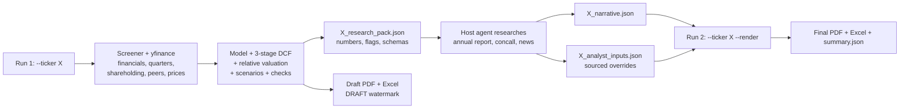

# Institutional-grade equity research agent - design

Status: approved 11-Nov-2026. Baseline and before/after numbers: [baseline.md](baseline.md).

## Problem

The engine is mechanically sound (the three statements articulate, Excel = Python, no invented numbers), but:

1. **Valuation gives indefensible calls.** RELIANCE SELL -58% (DCF Rs 201 vs CMP Rs 1,335), ASIANPAINT SELL -52%,
   TATATECH SELL -45%. Causes: a 5-year explicit period followed straight by a 5% Gordon terminal value with no fade
   and no reinvestment normalisation; a fixed 70/30 DCF / P/E blend; modelling bugs; no plausibility checks.
2. **The PDF is a 7-page data dump**: templated bullets, no thesis, industry or competition analysis, no peers,
   quarterly results or shareholding, forced page breaks, full-grid tables, unnumbered charts without sources.

## Requirements

1. Analysis and PDF are fixed in one plan; analysis first.
2. The host agent (Claude / Hermes) writes `<SYM>_narrative.json` and optionally `<SYM>_analyst_inputs.json`. Every
   analyst input cites a source (type, title, url or document, date) and is labelled "analyst input". The tool makes
   no LLM calls. Without a narrative the report still renders, qualitative sections are omitted, automatic text is
   labelled and a "DRAFT - narrative pending" watermark is shown.
3. Hybrid layout: Indian broker initiation front page (main column + sidebar) plus a global-style risk-reward box and
   bull / base / bear page.
4. Company brand colour throughout, darkened for text until it meets WCAG 4.5:1 contrast on white. White background.
5. Ratings BUY / ADD / REDUCE / SELL on 12-month expected total return = TP / CMP - 1 + dividend yield
   (defaults BUY > 15%, ADD 5-15%, REDUCE -5% to 5%, SELL < -5%).
6. All new valuation logic is live Excel formulas with Excel-vs-Python parity tests. One exception: the Scenarios
   sheet stores the two non-live scenarios as values, with a check cell proving the live scenario equals its stored value.
7. Banks / NBFCs remain out of scope. No consensus estimates (no free source); estimates are compared with history.
8. Existing CLI, exit codes, `write_pdf()` signature and output file names are kept.

## Style reference

A college finance-cell report on Hindustan Unilever (25 pages). We keep its breadth (company overview with segment
donuts, industry and market share, key risks, ESG, competitor table, SWOT, PESTLE, Porter's five forces with a
threat-rating table, M&A, ratio-vs-peer page with commentary and mini charts, technical view, DCF) and improve on:

| Reference report | Our version |
|---|---|
| WACC 5.83% (below the risk-free rate), TV 83% of EV, no sensitivity | CAPM WACC with Blume beta, 3-stage DCF, TV share checked, two sensitivity grids |
| No rating or target on page 1 | Front page states rating, target, expected return, thesis, key data |
| Generic SWOT / PESTLE / Porter | Each point needs company-specific evidence and a source |
| 2018 market-share data, few sources | Numbered exhibits with "Source:" lines; every agent input cited |
| Single-year peer ratios | Multi-year comps with one set of definitions |
| Hand-drawn chart levels | Moving averages, RSI and support / resistance computed from prices |
| Black pages, sparse layout | White, printable, dense two-column layout |
| No forecasts, quarters, shareholding | All included |

## Solution

### Valuation

* **3-stage DCF.** Explicit years 1-5 from the 3-statement model; fade years 6-10 where revenue growth falls linearly
  to g, the EBIT margin is held and reinvestment = growth / ROIC with ROIC moving linearly toward terminal RONIC;
  terminal FCFF = NOPAT x (1 - g / RONIC). Default terminal RONIC = WACC + 50% x (current ROIC - WACC), floored at
  WACC and capped at current ROIC (config, agent-overridable).
* **12-month target.** DCF rolled forward 12 months at Ke minus dividend yield; P/E vs own 5-year history on 12-month
  forward EPS; peer-median EV/EBITDA on forward EBITDA. Default weights 50 / 25 / 25. A sum-of-the-parts valuation
  replaces the blend when the agent supplies segment values.
* **Scenarios.** Bull / base / bear each run through forecast, DCF and relative valuation; the target is the base case;
  a probability-weighted value (25 / 50 / 25) is shown.
* **Credibility checks** (`equity_agent/checks.py`): TV > 75% of EV; DCF and relative values > 2x apart;
  |upside| > 40%; reverse DCF unreachable; driver clamped; negative final FCFF; market inputs > 90 days old;
  year-to-date growth vs FY1E growth gap > 5 pp. High-severity flags appear in the PDF and research pack, and the
  narrative must answer each.

### Narrative safety

The agent may write tokens such as `{{valuation.target_price}}`; the renderer fills them from the model. A lint
warns about numbers in the narrative that are neither tokens nor followed by a citation marker `[n]`.

### Report (about 16-20 pages)

Front page; story in charts; investment thesis; company overview; industry and competitive position (market share,
Porter's table, SWOT); PESTLE and ESG; quarterly results; financial analysis; peer comps and ratios vs peers;
forecasts and assumptions; valuation; scenarios and reverse DCF; technical view; risks and catalysts; corporate
actions; financial statements; methodology, sources, flags and disclosures. Code lives in `equity_agent/report/`;
`pdf_report.write_pdf(path, res)` is a thin wrapper.

## Tasks

1. Design spec and baseline (`scripts/baseline_report.py`).
2. Modelling bug fixes: exit value at t = 5; minority share of profit; unadjusted prices and per-year share count in
   historical P/E; loans & advances non-operating; year-1 working-capital glide; CWIP capitalised over 2 years.
3. Credibility checks wired into summary JSON, PDF and Excel cover.
4. 3-stage DCF with fade years in Python and Excel.
5. Blume beta, staleness flag, 12-month target, total-return ratings.
6. Shareholding, technicals, price performance, YTD-vs-FY1E check.
7. Peers and relative valuation, `Peers` and `Valuation Summary` sheets.
8. Full bull / base / bear scenarios and `Scenarios` sheet.
9. `analyst_inputs.json` with sourced overrides and SOTP.
10. Research pack, narrative schema, `--render`.
11. Report package and house style.
12. Front page (user checkpoint).
13. Data-driven sections.
14. Valuation, scenario and technical sections.
15. Narrative sections.
16. Disclosures, docs and full validation.

## Defaults (configurable)

* Terminal RONIC = WACC + 50% of the current ROIC premium over WACC (floor WACC, cap current ROIC).
* Target weights 50% DCF / 25% own-history P/E / 25% peer EV/EBITDA.
* Ratings BUY > 15%, ADD 5-15%, REDUCE -5% to 5%, SELL < -5% expected total return.
* White printable background; brand colour accents.
* Scenarios sheet stores the two non-live cases as values with a check cell.

## Result: before and after (12-Nov-2026)

Live data for all five stocks, run through both steps (draft, then `--render` with the host agent's
`output/agent/<SYMBOL>_narrative.json` and `_analyst_inputs.json`). Full tables, including the fixture baseline, are
in [baseline.md](baseline.md).

| Symbol | Before: target / upside / rating | Before: TV % EV | After: target / upside / rating | After: TV % EV | Final PDF pages |
|---|---|---|---|---|---|
| TCS | 3,049 / +23.3% / STRONG ACCUMULATE | 76% | 3,107 / +25.7% / BUY | 54% | 18 |
| RELIANCE | 563 / -57.8% / SELL | 68% | 794 / -40.5% / SELL | 61% | 19 |
| ASIANPAINT | 1,215 / -52.3% / SELL | 73% | 1,553 / -39.1% / SELL | 45% | 19 |
| TATATECH | 370 / -45.3% / SELL | 72% | 563 / -16.7% / SELL | 48% | 18 |
| MARUTI | 11,366 / -13.8% / REDUCE | 71% | 17,151 / +30.1% / BUY | 54% | 18 |

What changed the numbers: the 3-stage DCF with fade years and value-driver terminal value cut the terminal value share
of EV from 68-76% to 45-61%; the target moved from 70% DCF / 30% median P/E to 50% DCF / 25% own-history P/E (traded
prices, each year's share count) / 25% peer EV/EBITDA on next-twelve-months earnings, rolled forward 12 months; ratings
moved to expected total return. The host agent's sourced FY27 growth inputs (first-half results plus guidance) raised
the targets for ASIANPAINT, TATATECH and MARUTI.

Open points the reports state rather than hide:

* RELIANCE: the consolidated DCF and the market disagree (high flags). A sum-of-the-parts would replace the blend, but
  the sources gathered give quarterly, not full-year, segment EBITDA, and adding the listed Jio stake value on top of
  consolidated debt and minority interest would double count. The flag responses say the SELL is low confidence.
* ASIANPAINT and TATATECH: the DCF still extrapolates the FY23-FY26 growth rate after FY27, so the DCF sits far below
  the multiples (DCF_RELATIVE_DIVERGENCE). The flag responses explain why later years were not raised without evidence.

Final report: front page with rating, target, expected return, thesis, key risks and data sidebar; 18-19 pages;
about 50 numbered exhibits, each with a source line; numbered narrative sources. Drafts (no narrative) are 13 pages.
